<h1>¡Hola! Soy Mónica Gómez-Vadillo 👋</h1>

<h3>AI Engineer en formación | Data Scientist | Investigadora predoctoral</h3>

Desarrollando aplicaciones inteligentes que conectan la inteligencia artificial, la ingeniería de software, la ciencia de datos y la investigación científica.

📍 Madrid, España

  <a href="https://portfolio-monica-gomez-vadillo.vercel.app/es/">🌐 Portfolio</a> ·
  <a href="https://www.linkedin.com/in/monicagomezvadillo/">💼 LinkedIn</a> ·
  <a href="https://scholar.google.com/citations?user=ThkATL0AAAAJ&hl=es">🔬 Google Scholar</a> ·
  <a href="https://orcid.org/0009-0001-4295-0069">🆔 ORCID</a>

🌐 <a href="README.md">English</a> | <strong>Español</strong>

---

## Sobre mí

Soy **Data Scientist e investigadora predoctoral en Ecología** en el Museo Nacional de Ciencias Naturales (MNCN-CSIC), en Madrid. Actualmente estoy ampliando mis conocimientos hacia la **ingeniería de inteligencia artificial y el desarrollo de software**.

Mi trayectoria combina experiencia profesional en ciencia de datos, aprendizaje automático y análisis predictivo con investigación científica basada en grandes conjuntos de datos de biodiversidad, análisis geoespacial y modelización estadística.

Actualmente curso el programa de **AI Engineering de 4Geeks Academy**, centrado en desarrollar aplicaciones prácticas, integrar modelos de lenguaje y APIs, automatizar procesos y utilizar herramientas de ingeniería de software asistida por IA.

Me interesa transformar ideas y datos complejos en aplicaciones útiles, comprensibles y bien diseñadas.

- 🔬 **Investigación:** Nichos ambientales, patrones de biodiversidad y coexistencia de especies a diferentes escalas espaciales.
- 🧠 **Aprendizaje:** Aplicaciones con LLM, agentes de IA, automatización e ingeniería de inteligencia artificial.
- 💻 **Desarrollo:** Software científico, aplicaciones web y herramientas basadas en datos.
- 🚀 **Objetivo profesional:** Oportunidades junior en AI Engineering, IA aplicada, Machine Learning y Data Science.
- 🌍 **Disponibilidad:** Oportunidades remotas e híbridas, colaboraciones técnicas y proyectos interesantes.

---

## Tecnologías y herramientas

### Programación y datos

`Python` · `R` · `SQL` · `JavaScript` · `TypeScript` · `Pandas` · `NumPy` · `GeoPandas`

### Machine Learning y computación científica

`scikit-learn` · `TensorFlow` · `Keras` · `Modelización estadística` · `Análisis predictivo` · `QGIS`

### IA y automatización

`n8n` · `APIs de LLM` · `Groq` · `APIs REST` · `Desarrollo asistido por IA` · `Codex` · `GitHub Copilot`

### Desarrollo web y visualización

`React` · `HTML5` · `CSS3` · `Tailwind CSS` · `Vite` · `Streamlit` · `Dash` · `Plotly` · `Matplotlib`

### Herramientas y metodologías de desarrollo

`Git` · `GitHub` · `VS Code` · `Jupyter` · `Documentación de diseño de software (SDD)` · `Flujos de trabajo con agentes`

Mi experiencia incluye proyectos profesionales, investigación científica y formación continua. Distingo las tecnologías con experiencia consolidada de aquellas que sigo aprendiendo.

---

## Proyectos destacados

### 🔬 NHEX — Niche Hypervolume Explorer

**Software científico | Modelización ecológica | Visualización de datos**

Aplicación científica para explorar y comparar nichos ambientales multidimensionales de distintas especies.

Combina una interfaz desarrollada con Python y Dash con cálculos de hipervolúmenes en R, visualizaciones interactivas, procesamiento geoespacial y métricas de comparación de nichos.

**Tecnologías:** Python · Dash · R · Análisis geoespacial · Computación científica

**Estado:** Desarrollo activo como software de investigación.

[Explorar NHEX en mi portfolio](https://portfolio-monica-gomez-vadillo.vercel.app/es/#projects)

### 🤖 SnackCheck — Nutrition Verdict Workflow

**Integración de IA | Automatización | APIs**

Flujo automatizado de análisis nutricional desarrollado mediante n8n, JavaScript, Open Food Facts y la API de Groq.

Combina reglas nutricionales deterministas con explicaciones generadas mediante un LLM, manteniendo la lógica de clasificación independiente del modelo de lenguaje.

**Tecnologías:** n8n · JavaScript · APIs REST · Groq · Integración de LLM

[Ver código fuente](https://github.com/mgomezv26/snackcheck-nutrition-check-n8n) · [Explorar proyecto](https://portfolio-monica-gomez-vadillo.vercel.app/es/#projects)

### 🍽️ ¿Qué comemos? — Planificador de menús semanales

**Desarrollo web | Diseño de aplicaciones | Proyecto personal**

Aplicación web en desarrollo para simplificar la planificación semanal de comidas, la gestión de recetas y la organización de la compra.

Se basa en una colección compartida de recetas e incorpora interfaces para consultar recetas y organizar menús.

**Tecnologías:** React · TypeScript · Vite · Tailwind CSS · Supabase

**Estado:** En desarrollo. Repositorio de código privado.

[Explorar proyecto](https://portfolio-monica-gomez-vadillo.vercel.app/es/#projects)

### 🌍 Modelos de distribución de sapos europeos

**Machine Learning | Ciencia de datos geoespaciales | Trabajo Fin de Máster — 2024**

Proyecto de investigación que utiliza clasificadores Random Forest para modelizar patrones de idoneidad ambiental de tres especies europeas de sapos, comparando un escenario histórico con distintos escenarios climáticos para 2050.

Incluye procesamiento de datos de biodiversidad, integración de predictores ambientales, análisis geoespacial, evaluación de modelos y visualización científica.

Se conservan los resultados históricos originales, con documentación específica sobre sus limitaciones metodológicas y de reproducibilidad.

**Tecnologías:** Python · R · Random Forest · scikit-learn · GeoPandas · QGIS

[Ver repositorio de investigación](https://github.com/mgomezv26/SDM_Bufonidae)

### 🎨 Molicgv Art Studio — Portfolio artístico

**Desarrollo frontend | Diseño web responsive**

Página web responsive desarrollada para mostrar las obras y el trabajo creativo de una artista.

Construida con HTML semántico y CSS, incorporando diseños adaptativos, criterios de accesibilidad, metadatos estructurados e imágenes optimizadas.

**Tecnologías:** HTML5 · CSS3 · Git · GitHub Pages

[Visitar página web](https://mgomezv26.github.io/molicgv-art/) · [Ver código fuente](https://github.com/mgomezv26/molicgv-art)

---

## Investigación y formación académica

### Doctorado en Ecología — En curso

**Universidad Autónoma de Madrid | MNCN-CSIC**

*2024–Actualidad · Finalización prevista: 2027*

Mi investigación doctoral estudia las relaciones entre los nichos ambientales de las especies y los patrones de coexistencia a distintas escalas espaciales.

Desarrollo flujos de procesamiento de datos, modelos ecológicos, análisis geoespaciales y software científico utilizando Python y R.

**Experiencia internacional:** Investigadora visitante en el Institute of Marine Research (IMR), Noruega, entre marzo y mayo de 2025.

### Formación académica

- **Programa AI Engineering** — 4Geeks Academy | 2026–Actualidad
- **Doctorado en Ecología** — Universidad Autónoma de Madrid | Finalización prevista en 2027
- **Máster en Data Science y Business Analytics** — IMF / UCAV / Indra
- **Máster en Ecología** — Universidad Autónoma de Madrid
- **Grado en Biología** — Universidad Rey Juan Carlos

Mi trayectoria investigadora incluye publicaciones científicas revisadas por pares y participación en congresos nacionales e internacionales.

[Google Scholar](https://scholar.google.com/citations?user=ThkATL0AAAAJ&hl=es) · [ORCID](https://orcid.org/0009-0001-4295-0069) · [ResearchGate](https://www.researchgate.net/profile/Monica-Gomez-Vadillo?ev=hdr_xprf)

---

## Actividad en GitHub

  <picture>
    <source media="(prefers-color-scheme: dark)" srcset="./profile/overview.dark.svg">
    <source media="(prefers-color-scheme: light)" srcset="./profile/overview.light.svg">
    
  </picture>

  <picture>
    <source media="(prefers-color-scheme: dark)" srcset="./profile/contributions.dark.svg">
    <source media="(prefers-color-scheme: light)" srcset="./profile/contributions.light.svg">
    
  </picture>

  <picture>
    <source media="(prefers-color-scheme: dark)" srcset="./profile/languages.dark.svg">
    <source media="(prefers-color-scheme: light)" srcset="./profile/languages.light.svg">
    
  </picture>

---

## Contacto

Me interesan las oportunidades en **AI Engineering, Machine Learning y Data Science**, donde pueda combinar el desarrollo tecnológico con mi experiencia científica y analítica.

[🌐 Portfolio](https://portfolio-monica-gomez-vadillo.vercel.app/es/) · [💼 LinkedIn](https://www.linkedin.com/in/monicagomezvadillo/) · [🔬 Google Scholar](https://scholar.google.com/citations?user=ThkATL0AAAAJ&hl=es) · [🦋 Bluesky](https://bsky.app/profile/biomolic.bsky.social) · [𝕏 X](https://x.com/BioMolic)

**De las preguntas científicas al desarrollo de software inteligente.**
