### Hello World! 👋

<h1 align="center">I'm Mónica Gómez-Vadillo</h1>
<h3 align="center">Data Scientist | PhD Researcher | Specializing in AI Engineering</h3>

  <a href="https://www.linkedin.com/in/monicagomezvadillo/">LinkedIn</a> •
  <a href="https://github.com/mgomezv26">GitHub</a> •
  <a href="https://mgomezv26.github.io/BioMolic/">Website</a> •
  <a href="https://scholar.google.com/citations?user=ThkATL0AAAAJ&hl=es">Google Scholar</a>

---

### 👩‍💻 About Me

I'm a **Data Scientist and PhD Researcher** at the **Museo Nacional de Ciencias Naturales (MNCN-CSIC)** in Madrid, Spain.

My background combines professional experience in **machine learning, predictive analytics and data pipelines** with scientific research involving large-scale biodiversity datasets, statistical modelling and software development.

- 🔬 **Currently:** Researching ecological niches and species co-occurrence at large geographical scales.
- 💻 **Building:** NHEX, an interactive application for environmental niche modelling, developed with Python, Dash and R.
- 📊 **Previously:** Worked as a Data Scientist in the energy sector, developing forecasting models and automated data workflows.
- 🤖 **Learning:** AI Engineering at 4Geeks Academy, including AI-assisted development, LLM applications and agentic systems.
- 🌍 **Interested in:** AI Engineering, Applied AI, Data Science, scientific computing and building useful software.

### 🛠️ Technologies & Tools

**Programming & Data**

- Python · R · SQL · Pandas · NumPy

**Machine Learning & Analytics**

- scikit-learn · TensorFlow · Keras · Statistical Modelling · Predictive Analytics

**Applications & Visualization**

- Dash · Streamlit · Plotly · Matplotlib · ggplot2 · Power BI · QGIS

**Development & Automation**

- Git · GitHub · GitHub Copilot · Codex · REST APIs · n8n · VS Code

**Currently Exploring**

- AI Engineering · LLMs · RAG · AI Agents · FastAPI · Docker · Backend Development

### 🚀 Featured Projects

#### 🔬 NHEX — Niche Hypervolume Explorer

An interactive scientific application for multidimensional environmental niche analysis, combining Python/Dash interfaces with R-based statistical computation.

**Stack:** Python · Dash · R · Plotly

#### 🤖 [SnackCheck — AI-powered Nutrition Workflow](https://github.com/mgomezv26/snackcheck-nutrition-check-n8n)

An automated workflow that integrates the OpenFoodFacts and Groq APIs to retrieve food product information and generate nutritional feedback using an LLM.

**Stack:** n8n · JavaScript · REST APIs · Groq

#### 📊 Personal Finance Dashboard

An interactive finance management application for tracking expenses, savings and housing goals, using Python, Streamlit and Google Sheets.

**Stack:** Python · Streamlit · Pandas · Google Sheets API

#### 🎨 [molicgv.art — Art Portfolio](https://mgomezv26.github.io/molicgv-art/)

A personal art portfolio built from scratch to showcase textured acrylic paintings. Designed as a responsive static website with semantic HTML, accessible navigation, Schema.org microdata and optimized WebP imagery.

**Stack:** HTML5 · CSS3 · GitHub Pages  
**Links:** [Live website](https://mgomezv26.github.io/molicgv-art/) · [Source code](https://github.com/mgomezv26/molicgv-art)

### 🎓 Academic Background

- **PhD in Ecology (ongoing)** — Universidad Autónoma de Madrid / MNCN-CSIC | 2024–Present
- **AI Engineering Program (in progress)** — 4Geeks Academy | 2026–Present
- **MSc in Data Science and Business Analytics** — IMF / UCAV / Indra
- **MSc in Ecology** — Universidad Autónoma de Madrid
- **BSc in Biology** — Universidad Rey Juan Carlos

My research has resulted in peer-reviewed scientific publications and presentations at national and international conferences.

### 🤝 Connect with Me

  
  
  
  
  
  
  

---

### 📈 GitHub Activity

  <picture>
    <source media="(prefers-color-scheme: dark)" srcset="./profile/overview.dark.svg">
    <source media="(prefers-color-scheme: light)" srcset="./profile/overview.light.svg">
    
  </picture>

  <picture>
    <source media="(prefers-color-scheme: dark)" srcset="./profile/contributions.dark.svg">
    <source media="(prefers-color-scheme: light)" srcset="./profile/contributions.light.svg">
    
  </picture>

  <picture>
    <source media="(prefers-color-scheme: dark)" srcset="./profile/languages.dark.svg">
    <source media="(prefers-color-scheme: light)" srcset="./profile/languages.light.svg">
    
  </picture>

---

<em>Open to opportunities in Data Science, Applied AI and AI Engineering.</em>

  
