<h1>Hi, I'm Mónica Gómez-Vadillo 👋</h1>

<h3>AI Engineer in Training | Data Scientist | PhD Researcher</h3>

  Building intelligent applications at the intersection of AI,
  software engineering, data science and scientific research.

📍 Madrid, Spain

  <a href="https://portfolio-monica-gomez-vadillo.vercel.app/en/">🌐 Portfolio</a> ·
  <a href="https://www.linkedin.com/in/monicagomezvadillo/">💼 LinkedIn</a> ·
  <a href="https://scholar.google.com/citations?user=ThkATL0AAAAJ&hl=es">🔬 Google Scholar</a> ·
  <a href="https://orcid.org/0009-0001-4295-0069">🆔 ORCID</a>

  🌐 <strong>English</strong> |
  <a href="README.es.md">Español</a>

---

## About Me

I'm a **Data Scientist and PhD Researcher in Ecology** at the Museo Nacional de Ciencias Naturales (MNCN-CSIC), Madrid, currently expanding my expertise into **AI Engineering and software development**.

My background combines professional experience in data science, machine learning and predictive analytics with scientific research involving large-scale biodiversity datasets, geospatial analysis and statistical modelling.

I'm currently completing an **AI Engineering program at 4Geeks Academy**, focusing on building practical applications, integrating LLMs and APIs, automating workflows and developing software with AI-assisted engineering tools.

I enjoy turning complex ideas and data into useful, understandable applications.

- 🔬 **Researching:** Environmental niches, biodiversity patterns and species coexistence across spatial scales.
- 🧠 **Exploring:** LLM applications, AI agents, automation and AI engineering.
- 💻 **Building:** Scientific software, web applications and data-driven tools.
- 🚀 **Currently interested in:** Junior AI Engineering, Applied AI, Machine Learning and Data Science opportunities.
- 🌍 **Open to:** Remote and hybrid opportunities, professional collaborations and interesting projects.

---

## Tech Stack

### Programming & Data

`Python` · `R` · `SQL` · `JavaScript` · `TypeScript` · `Pandas` · `NumPy` · `GeoPandas`

### Machine Learning & Scientific Computing

`scikit-learn` · `TensorFlow` · `Keras` · `Statistical Modelling` · `Predictive Analytics` · `QGIS`

### AI & Automation

`n8n` · `LLM APIs` · `Groq` · `REST APIs` · `AI-assisted Development` · `Codex` · `GitHub Copilot`

### Web Development & Visualisation

`React` · `HTML5` · `CSS3` · `Tailwind CSS` · `Vite` · `Streamlit` · `Dash` · `Plotly` · `Matplotlib`

### Development Practices & Tools

`Git` · `GitHub` · `VS Code` · `Jupyter` · `Software Design Documentation (SDD)` · `Agent-assisted Workflows`

My experience spans professional applications, scientific research and ongoing training. I distinguish established experience from technologies I'm currently learning.

---

## Featured Projects

### 🔬 NHEX — Niche Hypervolume Explorer

**Scientific Software | Ecological Modelling | Data Visualisation**

A scientific application for exploring and comparing species' multidimensional environmental niches.

Combines a Python/Dash interface with R-based hypervolume calculations, interactive visualisations, geospatial processing and niche comparison metrics.

**Tech:** Python · Dash · R · Geospatial Analysis · Scientific Computing

**Status:** Active research software development.

[Explore NHEX in my portfolio](https://portfolio-monica-gomez-vadillo.vercel.app/en/#projects)

### 🤖 SnackCheck — Nutrition Verdict Workflow

**AI Integration | Automation | API Development**

An automated nutrition-analysis workflow developed with n8n, JavaScript, Open Food Facts and the Groq API.

It combines deterministic nutritional rules with LLM-generated explanations, keeping the classification logic separate from the language model.

**Tech:** n8n · JavaScript · REST APIs · Groq · LLM Integration

[View source code](https://github.com/mgomezv26/snackcheck-nutrition-check-n8n) · [Explore project](https://portfolio-monica-gomez-vadillo.vercel.app/en/#projects)

### 🍽️ ¿Qué comemos? — Weekly Meal Planner

**Web Development | Application Design | Personal Project**

An evolving web application designed to simplify weekly meal planning, recipe management and shopping organisation.

Built around a shared recipe collection, with meal-planning and recipe-browsing interfaces.

**Tech:** React · TypeScript · Vite · Tailwind CSS · Supabase

**Status:** Work in progress. Source repository currently private.

[Explore project](https://portfolio-monica-gomez-vadillo.vercel.app/en/#projects)

### 🌍 European Toad Species Distribution Modelling

**Machine Learning | Geospatial Data Science | Master's Thesis — 2024**

A research project applying Random Forest classifiers to model environmental suitability patterns for three European toad species across a historical baseline and climate scenarios for 2050.

Includes biodiversity data processing, environmental predictor integration, geospatial analysis, model evaluation and scientific visualisation.

The original historical outputs are preserved, with methodological limitations and reproducibility constraints documented.

**Tech:** Python · R · Random Forest · scikit-learn · GeoPandas · QGIS

[View research repository](https://github.com/mgomezv26/SDM_Bufonidae)

### 🎨 Molicgv Art Studio — Artist Portfolio Website

**Frontend Development | Responsive Web Design**

A responsive website developed to showcase an artist's acrylic paintings and creative work.

Built using semantic HTML and CSS, with responsive layouts, accessibility considerations, structured metadata and optimised imagery.

**Tech:** HTML5 · CSS3 · Git · GitHub Pages

[Live website](https://mgomezv26.github.io/molicgv-art/) · [Source code](https://github.com/mgomezv26/molicgv-art)

---

## Research & Academic Background

### PhD in Ecology — In Progress

**Universidad Autónoma de Madrid | MNCN-CSIC**

*2024–Present · Expected completion: 2027*

My doctoral research investigates the relationship between species' environmental niches and coexistence patterns across spatial scales.

I develop data-processing pipelines, ecological models, geospatial analyses and scientific software using Python and R.

**International research experience:** Visiting Researcher at the Institute of Marine Research (IMR), Norway — March–May 2025.

### Education

- **AI Engineering Program** — 4Geeks Academy | 2026–Present
- **PhD in Ecology** — Universidad Autónoma de Madrid | Expected 2027
- **MSc in Data Science and Business Analytics** — IMF / UCAV / Indra
- **MSc in Ecology** — Universidad Autónoma de Madrid
- **BSc in Biology** — Universidad Rey Juan Carlos

My research includes peer-reviewed scientific publications and presentations at national and international conferences.

[Google Scholar](https://scholar.google.com/citations?user=ThkATL0AAAAJ&hl=es) · [ORCID](https://orcid.org/0009-0001-4295-0069) · [ResearchGate](https://www.researchgate.net/profile/Monica-Gomez-Vadillo?ev=hdr_xprf)

---

## GitHub Activity

  <picture>
    <source media="(prefers-color-scheme: dark)" srcset="./profile/overview.dark.svg">
    <source media="(prefers-color-scheme: light)" srcset="./profile/overview.light.svg">
    
  </picture>

  <picture>
    <source media="(prefers-color-scheme: dark)" srcset="./profile/contributions.dark.svg">
    <source media="(prefers-color-scheme: light)" srcset="./profile/contributions.light.svg">
    
  </picture>

  <picture>
    <source media="(prefers-color-scheme: dark)" srcset="./profile/languages.dark.svg">
    <source media="(prefers-color-scheme: light)" srcset="./profile/languages.light.svg">
    
  </picture>

---

## Let's Connect

I'm interested in opportunities to apply and expand my experience in **AI Engineering, Machine Learning and Data Science**, combining technical development with a strong scientific and analytical background.

[🌐 Portfolio](https://portfolio-monica-gomez-vadillo.vercel.app/en/) · [💼 LinkedIn](https://www.linkedin.com/in/monicagomezvadillo/) · [🔬 Google Scholar](https://scholar.google.com/citations?user=ThkATL0AAAAJ&hl=es) · [🦋 Bluesky](https://bsky.app/profile/biomolic.bsky.social) · [𝕏 X](https://x.com/BioMolic)

**From scientific questions to intelligent software.**
